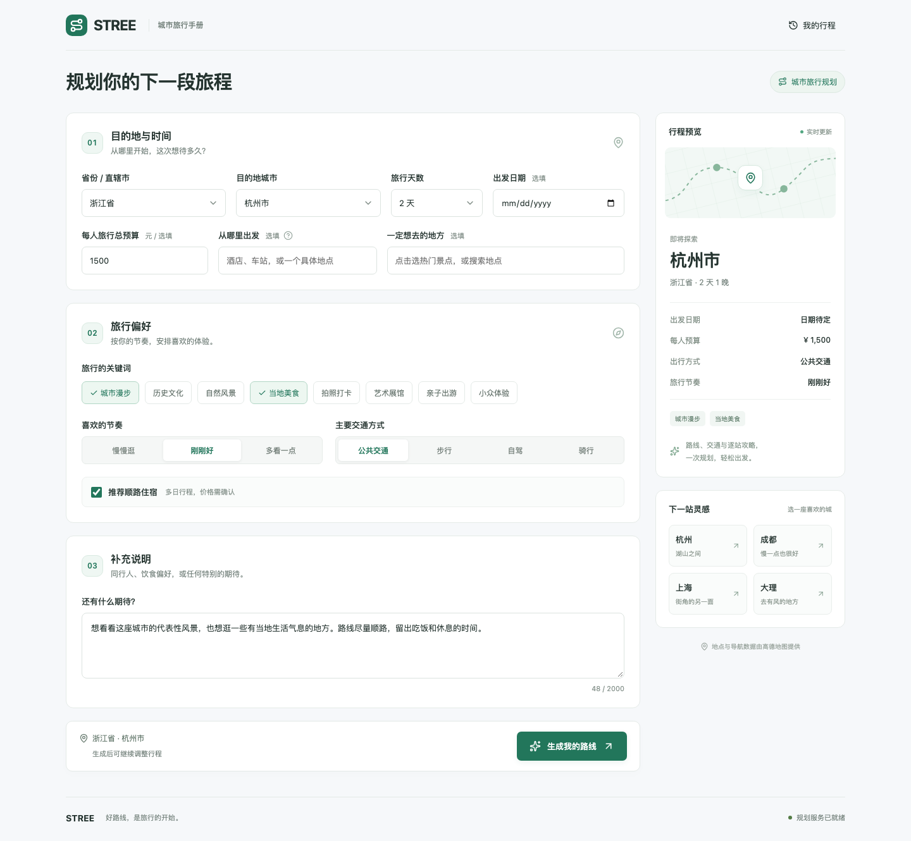
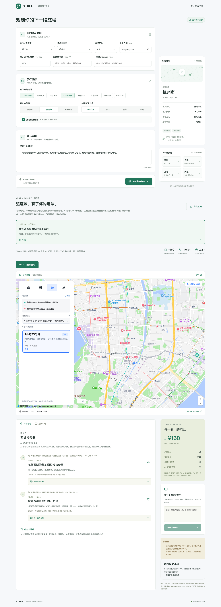
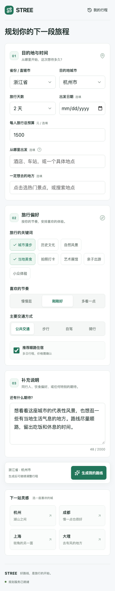
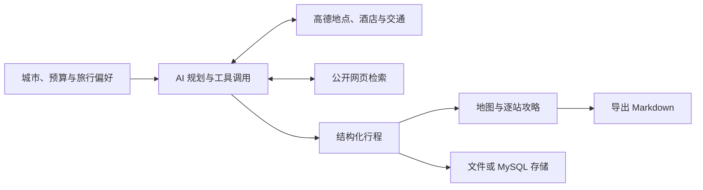

<div align="center">

# STREE · 城市旅行手册

**把旅行想法，变成地图上看得懂的城市行程。**

一个可自部署的 AI 旅行规划应用：自带模型 API，结合高德地点与交通数据，生成每日路线、逐站攻略和参考预算。

[](https://github.com/caihaodong111/stree/stargazers)


[界面预览](#界面预览) · [快速开始](#快速开始) · [模型接入](#模型接入) · [部署](#部署) · [常见问题](#常见问题) · [参与贡献](#参与贡献) · [软件著作权](#软件著作权) · [联系与合作](#联系与合作)

AI travel planner for Chinese cities, with AMap routes, bring-your-own models, and self-hosting.

</div>



## 一次规划，得到什么？

周末想去一座城，往往需要同时查景点、排路线、算交通、找住宿。STREE 把这些信息组织到同一份城市旅行手册中：填写目的地和偏好，查看 AI 生成的行程，再在地图上展开每一段交通。

- **按你的方式旅行**：每次规划一座城市、1–7 天；支持预算、出发日期、出发地点、必去地点、旅行节奏和兴趣偏好。
- **地点有出处**：通过高德查询景点、酒店与 POI，地点坐标取自地图服务。
- **路线可以展开看**：每日站点与地图联动；交通面板支持公交／地铁、步行、驾车与骑行查询，具体可用方案取决于高德返回结果。
- **攻略可以继续改**：查看逐站建议、时间安排和参考预算，用自然语言提出修改要求，重新生成原行程。
- **资料可以追溯**：模型可调用公开网页搜索工具，检索来源会保留在页面和导出的攻略中。
- **模型由你选择**：支持三种 API 协议，可接入兼容的模型厂商、网关或本地服务。
- **结果留在自己的部署里**：保存历史行程，一键导出 Markdown；默认使用本地文件，无需配置数据库。

> 模型 API 和高德服务需要自行配置，费用与配额由对应服务商决定。行程、时间与预算属于 AI 建议；地图查询结果与 AI 估算会分别展示，出行前仍需确认开放、预约和票价信息。

## 界面预览

以下为项目实际运行截图。首页展示需求填写，生成后可继续查看地图、每日行程、预算和攻略来源。

<details>
<summary><strong>展开查看完整结果：地图路线、逐站攻略与预算</strong></summary>



</details>

<details>
<summary><strong>展开查看移动端</strong></summary>



</details>

## 快速开始

### 1. 准备运行环境与账号

| 准备项                                     | 用途                         |
| ------------------------------------------ | ---------------------------- |
| Node.js **22.12+**、npm、Git               | 安装和运行项目               |
| 高德「Web 服务」Key                        | 后端查询城市、地点与交通     |
| 高德「Web 端（JS API）」Key 及对应安全密钥 | 浏览器加载地图               |
| 一个支持工具调用、可关闭思考模式的模型 API | 生成行程并调用地图、搜索工具 |

默认不需要 MySQL，也不需要安装或登录 Codex CLI。当前规划入口使用你在页面中配置的模型 API。

首次运行需要自行准备模型账号或 API Key，并配置模型提供方、API 根地址和模型 ID；相关费用由所使用的服务商收取。应用不会自动使用开发者本机的模型配置。

### 2. 下载项目并安装依赖

```bash
git clone https://github.com/caihaodong111/stree.git
cd stree
npm ci
```

创建本地配置文件。以下命令适用于 macOS、Linux 和 Git Bash，已有配置不会被覆盖：

```bash
[ -f backend/.env ] || cp backend/.env.example backend/.env
[ -f frontend/.env.local ] || cp frontend/.env.example frontend/.env.local
```

<details>
<summary>Windows PowerShell 创建配置文件</summary>

```powershell
if (!(Test-Path backend/.env)) { Copy-Item backend/.env.example backend/.env }
if (!(Test-Path frontend/.env.local)) { Copy-Item frontend/.env.example frontend/.env.local }
```

</details>

### 3. 填写高德配置

编辑 `backend/.env`，至少填写：

```dotenv
AMAP_WEB_SERVICE_KEY=你的高德Web服务Key
STORAGE_DRIVER=file
SETTINGS_ENABLED=true
```

编辑 `frontend/.env.local`：

```dotenv
VITE_API_BASE=/api
VITE_AMAP_KEY=你的高德JS_API_Key
VITE_AMAP_SECURITY_CODE=与JS_API_Key对应的安全密钥
```

两类 Key 需要分别申请，不能互换。申请与配置步骤见高德官方文档：[Web 服务 Key](https://lbs.amap.com/api/webservice/guide/create-project/get-key)、[JS API 安全配置](https://lbs.amap.com/api/javascript-api-v2/guide/abc/jscode)。按控制台要求配置服务权限及访问限制，允许实际使用的开发地址。

### 4. 启动应用，配置模型

```bash
npm run dev
```

打开 **[http://127.0.0.1:5173](http://127.0.0.1:5173)**。前端默认使用 `5173` 端口，后端使用 `8000`，开发服务器会代理 `/api` 请求。

在页面顶部打开 **设置**：

1. 添加模型提供方，填写 Provider ID、显示名称、API 根地址、协议和密钥。
2. 获取模型目录并添加所需模型；提供方不支持目录查询时，手动填写模型 ID。
3. 保存提供方，再在「规划设置」选择该提供方和规划模型，点击「保存设置」。

模型兼容条件与地址填写方式见下方[模型接入](#模型接入)。修改 `.env` 后需重启对应服务；模型设置保存后用于新任务。

### 5. 生成第一份旅行手册

先尝试一个需求明确的短行程：

| 字段     | 示例                                               |
| -------- | -------------------------------------------------- |
| 目的地   | 浙江省 → 杭州市                                    |
| 旅行天数 | 1 天                                               |
| 每人预算 | 500 元                                             |
| 必去地点 | 从输入提示中选择「西湖」相关地点                   |
| 交通方式 | 公共交通                                           |
| 旅行节奏 | 慢慢逛                                             |
| 补充说明 | 想沿西湖散步，顺路体验本地小吃，中午留出休息时间。 |

点击「生成我的路线」，查看任务进度。完成后，展开交通方案、查看每站攻略，或点击「导出攻略」下载 `.md` 文件。还可以输入「减少一个景点，多留一点吃饭和休息时间」继续修改。

**完成模型配置后**，可在另一个终端检查服务：

```bash
npm run check:services
```

尚未配置模型时该命令会返回失败；这是初始化状态提示。`model.configured` 和 `storage.available` 应为 `true`，`amap.configured` 表示已填写后端 Key。该检查会尝试一次高德行政区查询，模型字段只检查配置是否存在，完整可用性以实际规划为准。

## 模型接入

STREE 通过后端请求模型 API，支持以下协议。兼容同一种协议不代表所有模型都能用于规划：**所选模型必须支持工具调用，并能按应用要求关闭思考模式。**

| 设置中的协议值       | 接口类型           | 地址填写方式                                 |
| -------------------- | ------------------ | -------------------------------------------- |
| `openai-completions` | Chat Completions   | 填提供方 API 根地址，保留需要的 `/v1` 等路径 |
| `openai-responses`   | Responses          | 填提供方 API 根地址，保留需要的版本路径      |
| `anthropic-messages` | Anthropic Messages | 填提供方 API 根地址，末尾可带或不带 `/v1`    |

API 根地址示例：`https://vendor.example/v1`。这里的域名仅为占位示例，请替换成服务商提供的地址，**不要附加 `/chat/completions`、`/responses` 或 `/messages`**。

配置时留意：

- **Provider ID**：例如 `my-provider`，以小写字母开头，可使用小写字母、数字和连字符。
- **模型 ID**：填写 API 的实际标识，不是模型在官网上的宣传名称。
- **API 密钥**：填写与根地址配套的凭据；本地无认证服务可留空。编辑已有提供方时，留空保留已保存的密钥。
- **最大输出 Token**：按模型能力设置；Anthropic Messages 协议需要显式填写。行程较长时应留出足够输出空间。
- **JSON 模式**：仅在提供方支持相应 `response_format` 时启用；模型的工具调用与结构化输出能力都会影响结果稳定性。

模型配置保存在 `backend/.runtime/provider-settings.json`，重启后保留。密钥文件以 `0600` 权限写入，页面读取接口不返回已保存的密钥。更换模型不会影响已经开始执行的任务。

## 部署

### 本机运行构建产物

先按快速开始完成地图和模型配置，然后执行：

```bash
npm run build
npm start
```

打开 **[http://127.0.0.1:8000](http://127.0.0.1:8000)**。此时 Fastify 同时提供前端页面与 API。

构建后的前端隐藏设置入口；后端在 `NODE_ENV=production` 时默认关闭设置 API。生产部署应设置 `SETTINGS_ENABLED=false`，并预先准备模型配置。

### Docker Compose 部署

仓库已提供 [Dockerfile](Dockerfile) 和 [compose.yaml](compose.yaml)。先在本地配置并验证模型，再准备部署文件：

| 文件                                    | 内容                                                                  |
| --------------------------------------- | --------------------------------------------------------------------- |
| `deploy/backend.env`                    | 后端配置，至少填写高德 Web 服务 Key；按访问地址配置 `ALLOWED_ORIGINS` |
| `deploy/frontend.env`                   | 前端构建配置，填写 `VITE_API_BASE=/api`、JS API Key 和对应安全密钥    |
| `deploy/runtime/provider-settings.json` | 从本地已验证的 `backend/.runtime/provider-settings.json` 复制         |

新部署可先执行以下命令创建文件；已有部署应保留现有配置与运行目录：

```bash
mkdir -p deploy/runtime
[ -f deploy/backend.env ] || cp backend/.env.example deploy/backend.env
[ -f deploy/frontend.env ] || cp frontend/.env.example deploy/frontend.env
[ -f deploy/runtime/provider-settings.json ] || cp backend/.runtime/provider-settings.json deploy/runtime/provider-settings.json
```

编辑两份环境文件，确认模型 API 能从容器访问。本地模型服务的 `127.0.0.1` 指向容器自身，需改为容器可达的地址。

在 Linux 主机上设置运行目录权限，再构建并启动：

```bash
chmod 600 deploy/backend.env deploy/frontend.env deploy/runtime/provider-settings.json
sudo chown -R 1000:1000 deploy/runtime
docker compose build
docker compose up -d --wait
curl -f http://127.0.0.1/api/health
```

默认访问主机 **80** 端口。如需更改，在两条 Compose 命令前使用相同的端口变量，例如：

```bash
STREE_HTTP_PORT=8080 docker compose build
STREE_HTTP_PORT=8080 docker compose up -d --wait
```

行程、模型配置与调用记录保存在挂载的 `deploy/runtime/`。生产容器默认关闭设置 API；更新模型需修改配置文件后重启容器。更新前备份运行目录，前端地图配置变化后需重新构建。

详细说明见 [Docker 部署文档](deploy/README.md)。

## 工作原理



模型按需调用 `search_places`、`search_hotels`、`measure_route` 和 `web_search`，将查询结果组织成行程。后端解析结构化结果、绑定取得的地点与地图资料，并保存任务记录；前端通过 SSE 展示规划进度。

最终行程保留 AI 生成的站点顺序、时间和预算。**格式校验不等于行程可行性校验**：当前后端不自动验证必去点覆盖、时间冲突、预算是否超支，也不保证 AI 建议的交通一定可用。打开交通面板时可独立查询高德导航；导航查询失败不会撤销已生成的攻略。

公开网页检索依赖搜索结果页，不保证覆盖小红书、抖音等平台内容，也不代表已读取来源全文。地图路径取决于高德服务覆盖；无导航数据时不会绘制伪造路径。

## 配置与数据

完整环境变量示例见 [backend/.env.example](backend/.env.example) 和 [frontend/.env.example](frontend/.env.example)。常用选项：

| 变量                       | 默认值               | 用途                               |
| -------------------------- | -------------------- | ---------------------------------- |
| `STORAGE_DRIVER`           | `file`               | 本地文件存储；也可选 `mysql`       |
| `APP_HOST` / `APP_PORT`    | `127.0.0.1` / `8000` | 后端监听地址与端口                 |
| `SETTINGS_ENABLED`         | 开发开启、生产关闭   | 是否注册模型设置 API               |
| `WEB_SEARCH_ENABLED`       | `true`               | 是否启用公开网页检索               |
| `MODEL_MAX_TOOL_ROUNDS`    | `8`                  | 查询阶段的模型轮数预算             |
| `MODEL_MAX_TOOL_CALLS`     | `32`                 | 查询阶段的工具调用预算             |
| `MODEL_TIMEOUT_MS`         | `600000`             | 整次生成的时间上限，毫秒           |
| `MODEL_REQUEST_TIMEOUT_MS` | `240000`             | 单次模型请求的时间上限，毫秒       |
| `AMAP_REQUEST_INTERVAL_MS` | `400`                | 高德请求间隔，毫秒                 |
| `ALLOWED_ORIGINS`          | 本地前端地址         | 允许的跨域来源，多个地址以逗号分隔 |

默认文件存储的主要目录：

```text
backend/.runtime/
├── provider-settings.json   # 模型提供方、密钥与当前选择
├── trips/                   # 已保存的行程
├── ai-runs/                 # AI 任务、模型/工具调用与事件记录
└── backups/                 # 执行迁移或导出时生成的备份
```

模型与工具调用的输入、公开输出、用量（上游返回时）和错误会保存在运行记录中。备份运行目录时，也请按私人行程与模型凭据管理这些文件。`.env`、运行目录和部署凭据已加入 `.gitignore`；前端 `VITE_*` 变量会进入浏览器构建产物，模型密钥与高德 Web 服务 Key 应保留在后端。

当前没有用户登录与独立账号数据隔离。个人使用可保持默认的本机监听；对外提供服务时需在部署层增加访问认证与限流，关闭设置接口本身不构成访问控制。

<details>
<summary><strong>可选：MySQL 与旧数据迁移</strong></summary>

首次体验使用文件存储即可。已有 MySQL 部署可在 `backend/.env` 设置 `STORAGE_DRIVER=mysql` 以及 `MYSQL_HOST`、`MYSQL_PORT`、`MYSQL_USER`、`MYSQL_PASSWORD`、`MYSQL_DATABASE`。

- `npm run db:setup`：创建所需表。
- `npm run db:ai-setup`：仅建立 AI 记录相关表。
- `npm run db:migrate`：升级旧结构并导入本地行程，执行前备份数据库与本地数据；还会删除当前应用已废弃的 `route_plan_items`、`route_plans`、`hotel_pois`、`pois` 四张表，请先核对用途。
- `npm run db:export-files`：从 MySQL 导出到本地文件，保留原数据库，备份与条数清单写入 `backend/.runtime/backups/`。完成后切换 `STORAGE_DRIVER=file` 并重启。

迁移细节以 [迁移实现](backend/src/db/migrate.ts) 与 [导出实现](backend/src/scripts/export-files.ts) 为准。

</details>

## 常见问题

| 问题                                | 排查方式                                                                                                                         |
| ----------------------------------- | -------------------------------------------------------------------------------------------------------------------------------- |
| 启动时报 Node 或依赖版本错误        | 使用 Node.js 22.12+，在仓库根目录执行 `npm ci`。                                                                                 |
| 还没配置模型，服务检查就失败了      | 先执行 `npm run dev`，在页面保存提供方与规划模型，再运行 `npm run check:services`。                                              |
| 设置按钮不显示                      | 构建产物会隐藏设置入口。首次配置请使用 `npm run dev`，并确认后端 `SETTINGS_ENABLED=true`、设置接口可访问。                       |
| 地图空白、Key 无效或城市查询失败    | 分别检查 Web 服务 Key、JS API Key、安全密钥、权限、配额与访问限制；修改前端环境变量后重启开发服务或重新构建。                    |
| 提供方返回 401／403，或获取不到模型 | 核对根地址、协议、密钥及模型权限；不支持模型目录查询的服务可手动添加模型 ID。                                                    |
| 提示模型不支持关闭思考              | 更换支持非思考模式和工具调用的模型；当前规划链路拒绝返回思考内容的模型响应。                                                     |
| 生成耗时较长或失败                  | 查看页面进度与后端错误；检查模型服务延迟、输出上限和地图／搜索网络。可先缩短天数与必去点数量，排除超时和输出格式问题。           |
| 定位失败                            | 在 HTTPS 或 localhost／127.0.0.1 下允许定位，也可以直接手动选择城市。网络定位受代理出口影响。                                    |
| 公交或某段导航没有结果              | 检查地点是否选对、服务覆盖与交通方式；AI 行程建议和高德导航是两类结果，可切换方式重查。                                          |
| 重启后数据不见了                    | 本地检查 `backend/.runtime/`，Docker 检查 `deploy/runtime/` 挂载与目录权限。已结束任务可读取；服务重启不会自动续跑执行中的任务。 |
| 能免费使用吗？                      | 模型与地图额度由各自服务商管理，一次规划可能调用模型及工具多次；部署者需自行承担实际费用。                                       |

## 开发与扩展

### 技术栈

| 层       | 实现                                                     |
| -------- | -------------------------------------------------------- |
| 前端     | React 19、TypeScript、Vite、Lucide、高德 JS API 2.0      |
| 后端     | Node.js 22+、Fastify 5、TypeScript                       |
| 共享契约 | Zod schema 与跨端类型                                    |
| 模型     | Chat Completions、Responses、Anthropic Messages 协议适配 |
| 数据     | 默认本地 JSON 文件与事件记录，可选 MySQL                 |
| 测试     | Vitest、Playwright 桌面与移动端场景                      |
| 部署     | Docker 多阶段构建、Compose、健康检查、运行目录持久化     |

### 目录导航

```text
stree/
├── frontend/src/         # 页面、地图、设置、历史与攻略导出
├── backend/src/
│   ├── models/           # 提供方配置、协议适配与模型工具循环
│   ├── services/         # 高德、行政区与公开网页检索
│   ├── planning/         # 规划任务、进度、取消与调用记录
│   └── db/               # 文件 / MySQL 存储与迁移
├── packages/shared/src/  # 前后端共享类型与 Zod schema
├── tests/                # 单元、API 与浏览器测试
├── deploy/               # Docker 部署说明
└── output/               # 界面截图与验证记录
```

### 常用命令

在仓库根目录执行：

```bash
npm run typecheck              # 检查共享契约、后端与前端类型
npm test                       # 单元与 API 测试，自动构建共享包
npx playwright install chromium
npm run test:e2e               # 桌面与移动端浏览器测试
npm run build                  # 构建全部工作区
```

浏览器测试使用测试数据与地图替身，不能替代真实模型和高德链路的验证。需要诊断公开网页检索时：

```bash
npm run check:web-search -- --search-only  # 仅检索公开网页
npm run check:web-search                  # 使用已配置模型验证工具循环，会产生 API 用量
```

### API 入口

| 接口                                                    | 用途                                       |
| ------------------------------------------------------- | ------------------------------------------ |
| `GET /api/health`、`GET /api/status`                    | 存活检查与服务配置状态                     |
| `GET /api/regions/provinces`、`GET /api/regions/cities` | 省市目录                                   |
| `GET /api/places/suggest`                               | 地点输入提示                               |
| `POST /api/plans`                                       | 创建规划；可带 `previousTripId` 修改原行程 |
| `GET /api/jobs/:id`、`GET /api/jobs/:id/events`         | 任务状态与 SSE 进度                        |
| `POST /api/jobs/:id/cancel`                             | 取消任务                                   |
| `GET /api/trips`、`GET /api/trips/:id`                  | 行程列表与详情                             |
| `GET /api/ai/runs`、`GET /api/ai/runs/:jobId`           | AI 任务与调用记录                          |

请求与数据结构见 [共享契约](packages/shared/src/index.ts)，路由实现见 [backend/src/app.ts](backend/src/app.ts)。

## 参与贡献

欢迎用真实旅行需求帮助改进 STREE，也欢迎提交代码、文档和界面优化。

提交前请按[安全说明](SECURITY.md)启用本地密钥检查，避免把个人凭据带入提交历史。

- **报告问题**：在 [Issues](https://github.com/caihaodong111/stree/issues) 中提供复现步骤、运行方式、模型协议与模型 ID、脱敏错误和预期结果。请移除 API Key、精确住址和私人行程信息。
- **提出需求**：说明具体使用场景，例如带老人出行、雨天调整或无障碍路线，以及当前流程遇到的困难。
- **提交 PR**：Fork 仓库，创建分支，完成修改并说明行为变化与验证方式。涉及代码时运行类型检查和相关测试；涉及界面时附桌面或移动端截图。

可参与的改进方向包括模型兼容性、行程质量评估、地图交互、无障碍体验、多语言文档，以及部署与访问控制。这些是欢迎讨论的方向，尚不代表已实现的功能或发布承诺。

如果 STREE 帮你安排了一次旅行，欢迎分享使用体验，也可以点一个 **Star**，方便继续关注项目。

## 软件著作权

软件著作权登记信息如下，名称与版本按证书原文展示：

| 项目     | 证书记载                   |
| -------- | -------------------------- |
| 软件名称 | 基于AI的个性化旅行规划系统 |
| 简称     | 智悦规划                   |
| 登记版本 | V1.0                       |
| 登记号   | `2025SR1317783`            |
| 证书号   | 软著登字第15973981号       |
| 登记日期 | 2025 年 7 月 21 日         |

<details>
<summary><strong>查看软件著作权登记证书（姓名与单位名称已打码）</strong></summary>


为保护隐私，证书中的所有个人姓名、单位名称及二维码、条码均已遮挡。

[查看脱敏版证书 PDF](output/pdf/software-copyright-redacted.pdf)

</details>

## 联系与合作

**联系方式：看主页。** 请查看[我的 GitHub 主页](https://github.com/caihaodong111)，通过主页公开的联系方式联系。

**商用合作请联系。** 欢迎就商业合作、定制开发与项目合作进行交流。

## 许可与致谢

项目根目录许可证暂未确定，许可信息待补充。

模型设置界面的部分组件改编自 DeepSeek Harness；来源、适配范围与其 MIT 许可证分别保留在[组件说明](frontend/src/components/harness-settings/README.md)和[组件许可证](frontend/src/components/harness-settings/LICENSE)中，该许可证仅适用于对应第三方组件。

感谢高德开放平台及项目所使用的开源工具。
