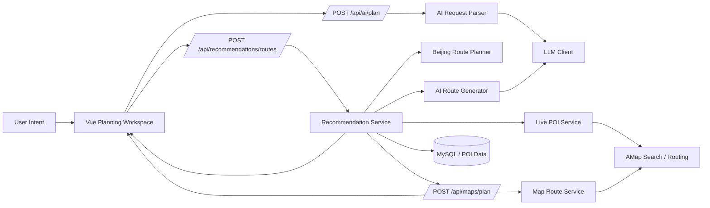
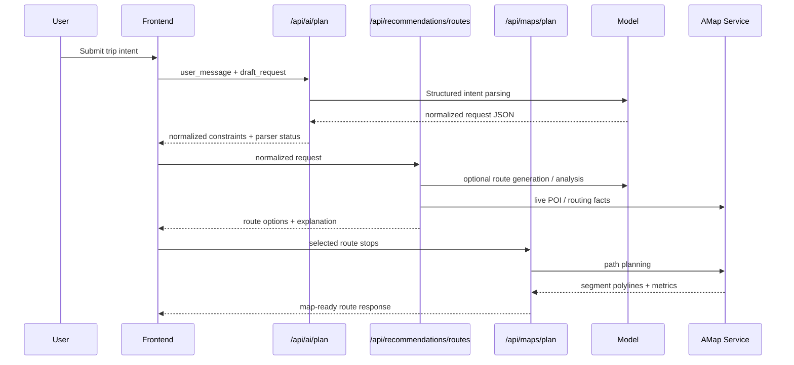

# STREE

> AI-native travel planning system for Beijing.  
> Turn vague user intent into structured trip constraints, route candidates, map-ready paths, and explainable itinerary decisions.

<p align="left">
  
  
  
  
  
</p>

## Overview

| Highlights | Demo Flow | Architecture Snapshot |
| --- | --- | --- |
| Natural-language trip intent parsing | User input -> AI normalization -> route planning -> map rendering | Vue frontend + FastAPI backend + planner + live map provider |
| Deterministic fallback when AI is unstable | Explainable route options with stop-by-stop reasoning | Structured schemas across AI, recommendation, and map layers |
| Real path segments instead of prompt-only routes | Route cards, map polylines, and segment summaries in one workspace | Ready to extend to more cities, providers, and optimization engines |

### Architecture Snapshot



### Request Flow



STREE is not a simple "tourist spots list" project. It is an end-to-end route planning system built around a clearer product idea:

- users describe what they want in natural language
- the system normalizes intent into structured constraints
- a planner selects feasible POIs and route order
- map services convert the route into real path segments
- AI and rules together explain why this plan is worth taking

The current scope focuses on **Beijing city trips**, but the architecture is already split into planner, provider, schema, AI orchestration, and frontend visualization layers, which makes it suitable for extension into a broader urban travel planning platform.

## Why This Project Exists

Most travel tools solve only one layer of the problem:

- some are good at listing attractions, but weak at route composition
- some can generate pretty text, but cannot guarantee feasibility
- some can draw a path on a map, but cannot explain why the route is arranged that way

STREE is designed to combine all three:

1. **constraint understanding**
2. **route generation**
3. **explainable visualization**

The result is a planning workflow that is closer to a real product than a demo prompt wrapper.

## Core Capabilities

### 1. AI intent parsing

Users can submit natural-language requests such as:

> "我想从天安门出发，周末两天去故宫和颐和园，整体均衡一些。"

The backend first converts this into a normalized request object:

- origin
- must-visit POIs
- budget
- available hours or travel days
- district preferences
- planning mode
- user preference switches

This step is handled by the AI orchestration layer with structured fallback logic, so the system can still work even when model output is unstable or unavailable.

### 2. Route planning with feasibility checks

STREE does not let AI invent arbitrary coordinates or routes.

Instead, planning is split into two stages:

- AI may help select and explain route candidates
- code remains responsible for feasibility filtering, POI matching, ordering, scoring, and fallback generation

The planner evaluates routes with multiple signals:

- budget fit
- time efficiency
- geographic compactness
- richness of content
- preference alignment

### 3. Live map routing

After candidate routes are selected, the backend can call AMap Web Service to compute:

- walking routes
- driving routes
- public transit routes

The frontend then renders:

- origin marker
- ordered stop markers
- polyline path segments
- segment-level duration, distance, and price summaries

### 4. Explainable output

Every route is designed to be readable by humans, not just machines.

The system can return:

- recommendation summary
- route title
- high-level reason for choosing the route
- stop-by-stop highlights
- itinerary blocks with suggested time windows
- map segment explanations

That makes STREE closer to an explainable planning engine than a static recommendation page.

## Product Principles

The project follows a few explicit design rules:

- **AI is responsible for interpretation and explanation, not for fabricating facts**
- **routing facts come from code and map providers, not from prompt guesses**
- **user-selected must-visit POIs should be respected by default**
- **missing constraints should not silently become fake hard limits**
- **fallback behavior must stay visible instead of pretending AI always succeeded**

These principles are reflected in the code structure and recent changes to request normalization, route fallback semantics, and frontend status messaging.

## System Architecture

```text
Frontend (Vue 3 + TypeScript)
  ├─ collect user input
  ├─ call AI planning endpoint
  ├─ call recommendation endpoint
  ├─ render route cards, explanation, and map
  └─ display segment-level path analysis

Backend (FastAPI)
  ├─ API router
  ├─ AI request parser / orchestrator
  ├─ recommendation service
  ├─ rule-based planner
  ├─ live POI service
  ├─ live route service / AMap provider
  └─ schema / repository / model layers

Data
  ├─ MySQL POI storage
  ├─ seed data
  ├─ official sync tasks
  └─ live AMap search and routing results
```

## Tech Stack

- **Backend**: FastAPI, SQLAlchemy, Pydantic
- **Frontend**: Vue 3, Vite, TypeScript
- **Database**: MySQL
- **Map Services**: AMap Web JS API, AMap Web Service API
- **LLM Layer**: OpenAI-compatible interface, currently configured for Zhipu-compatible models

## Repository Structure

```text
backend/
  app/
    api/          # REST endpoints
    core/         # config, logging, database bootstrap
    data/         # local POI data
    models/       # SQLAlchemy models
    planners/     # deterministic planning engine
    providers/    # external service providers (e.g. AMap)
    repositories/ # DB access
    schemas/      # request/response contracts
    services/     # orchestration, AI, live POI, live route
    tasks/        # sync / crawler tasks
  init_db.py
  seed_pois.py
  sync_official_pois.py

frontend/
  src/
    api/          # API client
    components/   # route cards, map, forms
    data/         # suggestion helpers
    lib/          # AMap loader and helpers
    types.ts      # shared frontend contracts
    App.vue       # integrated planning workspace
```

## Current Workflow

The end-to-end request flow looks like this:

1. User submits travel intent from the frontend
2. `/api/ai/plan` converts text into a normalized planning request
3. `/api/recommendations/routes` generates candidate routes
4. The backend returns summaries, stop highlights, and route options
5. The frontend selects a route and requests map path analysis
6. The map component renders markers, path polylines, and segment notes

This separation is important: the system does not rely on a single LLM response to do everything.

## Local Development

### Backend

```bash
cd backend
python3 -m venv .venv
source .venv/bin/activate
pip install -r requirements.txt
python init_db.py
python seed_pois.py
uvicorn app.main:app --reload --host 0.0.0.0 --port 8000
```

Optional data sync:

```bash
cd backend
python sync_official_pois.py --limit 10
python sync_official_pois.py --replace
```

### Frontend

```bash
cd frontend
npm install
npm run dev
```

Default local URL:

```text
http://localhost:5173
```

Vite proxies `/api` to the backend in development, so local integration works without extra CORS setup.

## Environment Configuration

### Backend

`backend/.env`

```bash
APP_NAME=STREE Beijing Travel Planner
APP_ENV=development

MYSQL_HOST=...
MYSQL_PORT=3306
MYSQL_USER=...
MYSQL_PASSWORD=...
MYSQL_DATABASE=stree

LLM_PROVIDER=zhipu
LLM_API_KEY=...
LLM_BASE_URL=https://open.bigmodel.cn/api/paas/v4
LLM_MODEL=glm-4.7

AMAP_WEB_SERVICE_KEY=...
AMAP_TRANSIT_CITY=北京
```

### Frontend

`frontend/.env.local`

```bash
VITE_AMAP_KEY=...
VITE_AMAP_SECURITY_CODE=...
```

## API Surface

- `GET /api/health`
- `POST /api/ai/plan`
- `POST /api/recommendations/routes`
- `POST /api/maps/plan`
- `GET /api/pois/suggestions`

## What Makes This Interesting

This repo is interesting not because it has an LLM endpoint, but because it tries to solve a harder engineering problem:

**how to combine AI interpretation, deterministic planning, live map data, and user-facing explanation in one coherent system.**

That makes it relevant for:

- travel recommendation products
- city companion tools
- explainable AI planning interfaces
- map-centric consumer apps
- AI orchestration patterns with rule-based safety rails

## Roadmap

High-value next steps:

- multi-city support with city-specific planner modules
- better POI freshness from official and licensed sources
- richer route constraint controls
- user profile, saved trips, and history-aware planning
- hotel / ticket / meal integration
- route optimization with matrix services or OR-Tools
- stronger observability around AI success, fallback, and route quality

## Status

STREE is already beyond a toy demo:

- it has a real backend/frontend split
- it has structured schemas
- it has deterministic fallback behavior
- it has live map routing support
- it has explainable route output

The current stage is best described as:

**an AI-enhanced travel planning MVP with production-oriented architecture.**
